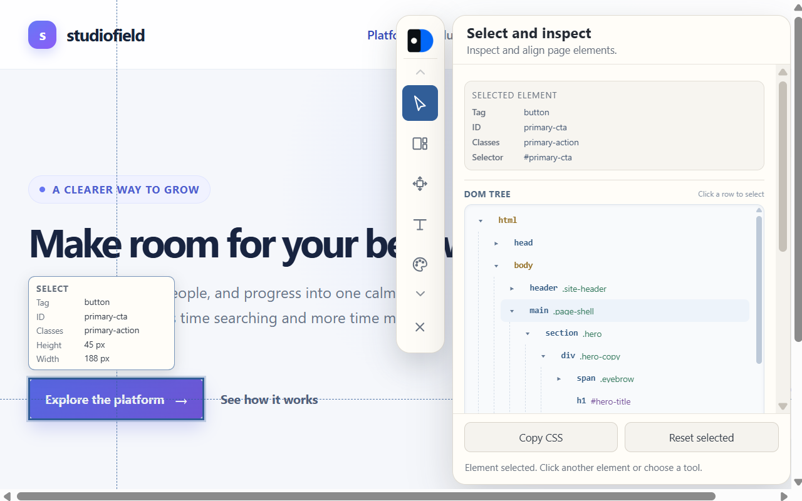
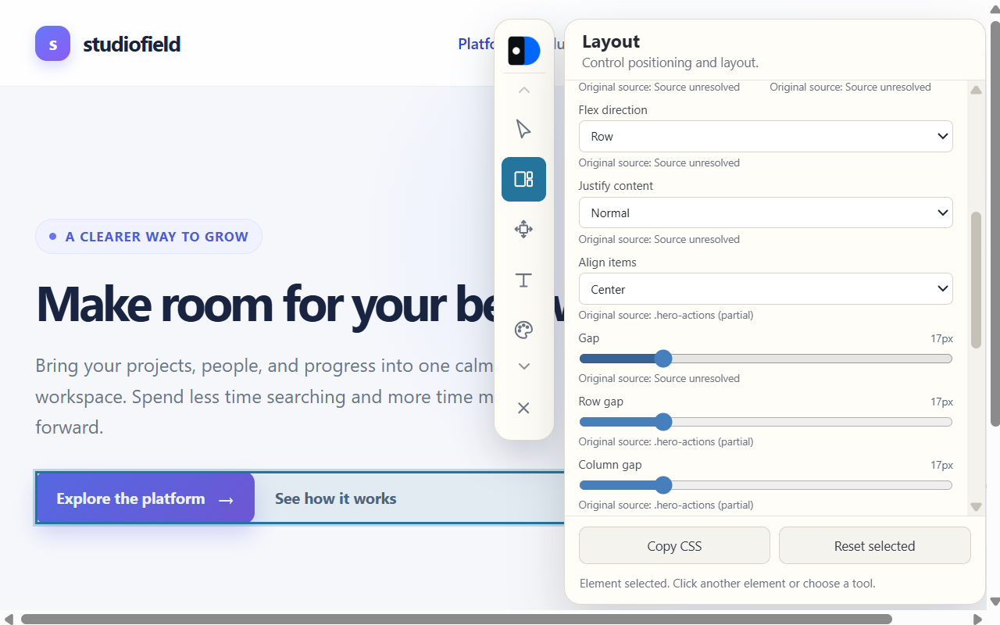
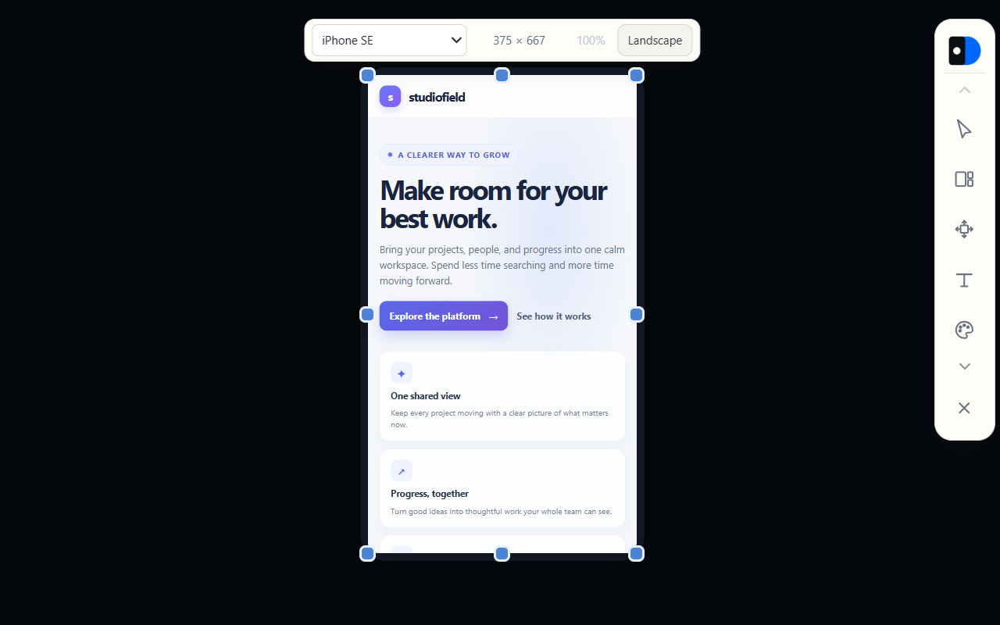

# Domino ✨

  

### 🎨 Give the page you're browsing a little design nudge.

Domino turns any webpage into a tiny CSS playground. Pick an element, tweak it, and watch your ideas land instantly - no stylesheet treasure hunt required.

## 🪄 Play with the pixels

- 🖱️ Grab an element right from the page or find it in the DOM tree.
- 🎨 Tinker with typography, color, spacing, layout, borders, and effects.
- 📱 Preview your design at mobile sizes before calling it done.
- 📋 Copy the CSS when a tweak is too good to keep temporary.

**Pick a palette:** 🔴 🟠 🟡 🟢 🔵 🟣

Your edits live on the page while you experiment. Refresh to start fresh - or copy your favorite CSS and keep the magic. ✨

## 👀 Take a peek

### Pick an element

### Tweak the layout

### Preview on mobile

